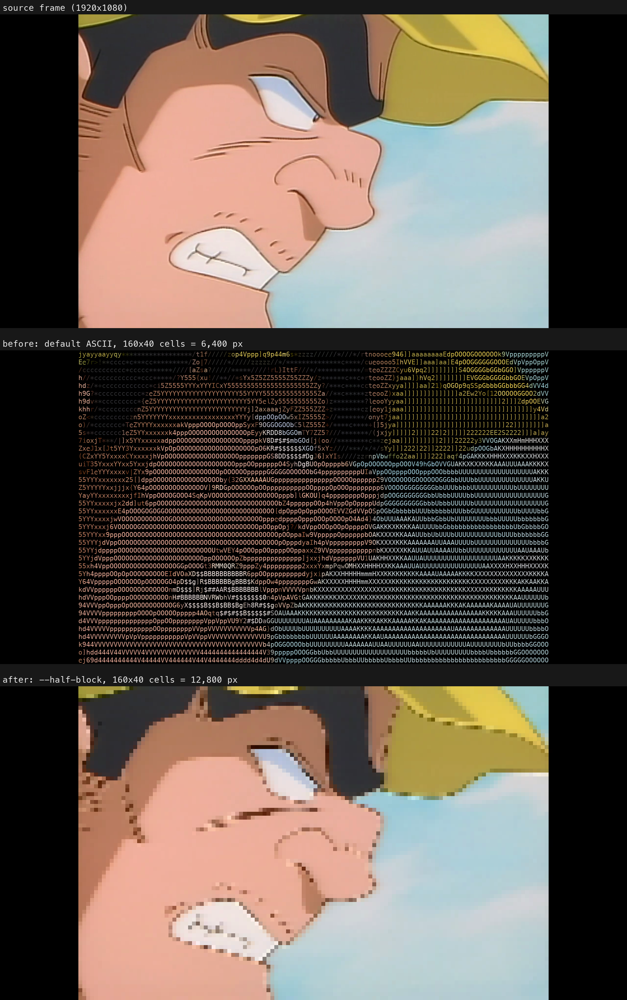

```text
 █████╗ ███████╗ ██████╗██╗██╗     ██╗███╗   ██╗███████╗  ██
██╔══██╗██╔════╝██╔════╝██║██║     ██║████╗  ██║██╔════╝  █████
███████║███████╗██║     ██║██║     ██║██╔██╗ ██║█████╗    ████████
██╔══██║╚════██║██║     ██║██║     ██║██║╚██╗██║██╔══╝    ████████
██║  ██║███████║╚██████╗██║███████╗██║██║ ╚████║███████╗  █████
╚═╝  ╚═╝╚══════╝ ╚═════╝╚═╝╚══════╝╚═╝╚═╝  ╚═══╝╚══════╝  ██

```
<a href="https://trendshift.io/repositories/50861?utm_source=trendshift-badge&amp;utm_medium=badge&amp;utm_campaign=badge-trendshift-50861" target="_blank" rel="noopener noreferrer"></a>
<a href="https://trendshift.io/repositories/50861?utm_source=trendshift-badge&amp;utm_medium=badge&amp;utm_campaign=badge-trendshift-50861" target="_blank" rel="noopener noreferrer"></a>
<a href="https://trendshift.io/repositories/50861?utm_source=trendshift-badge&amp;utm_medium=badge&amp;utm_campaign=badge-trendshift-50861" target="_blank" rel="noopener noreferrer"></a>

**ASCILINE** is a high-performance, cross-platform real-time ASCII video rendering engine. It maps pixels to text-based representations and streams the result over a low-overhead binary protocol, turning the browser canvas into a typographic display surface.

[](#0-requirements)
[](https://developer.mozilla.org/en-US/docs/Web/JavaScript)
[](https://fastapi.tiangolo.com/)
[](https://opencv.org/)
[](https://numpy.org/)
[](https://developer.mozilla.org/en-US/docs/Web/API/Canvas_API)
[](LICENSE-AGPL)
[](LICENSE-MIT)

| Output | Details |
| :--- | :--- |
|  | **Original Source**<br>Standard MP4 video file. |
|  | **ASCII Mode**<br>Rendered using Mode 4 (32K colors) from a 30fps source. |
|  | **PIXEL Mode**<br>Rendered using the `--pixel` flag for high fidelity colored blocks █ . |

## Table of Contents

- [Design Goals](#design-goals)
- [Technical Features](#technical-features)
- [Architecture](#architecture)
- [Adaptive Frame Codec (opt-in, ASCII modes 2-6)](#adaptive-frame-codec-opt-in-ascii-modes-2-6)
- [Zero-Dependency Static Web Player](#zero-dependency-static-web-player)
- [JavaScript SDK (asciline-player)](#javascript-sdk-asciline-player)
- [Installation](#installation)
  - [Optional: Rust engine + live pixel DCT](#optional-rust-engine--live-pixel-dct-preview-windows-tested)
- [Running with Docker](#running-with-docker)
- [Customization](#customization)
- [Troubleshooting](#troubleshooting)
- [Live Demo](#live-demo)
- [Star History](#star-history)
- [Support ❤️](#support)
- [License](#license)
- [Community](#community)
- [Contact](#contact)

## Design Goals

1. **Pure typographic manipulation**: the visual stream is raw HTML/Canvas text, not a standard media file. That means real-time CSS filters (glows, shadows, animations) can be applied directly to what would otherwise be a video.
2. **Zero GPU, ultra-low bandwidth (ASCII modes)**: standard codecs (H.264/VP9) need dedicated hardware decoders, which chokes microcontrollers and weak devices. ASCILINE does the heavy lifting server-side and streams lightweight text frames — fewer columns means proportionally less bandwidth. This makes fluid playback possible on constrained networks and zero-GPU devices (smart appliances, retro terminals, basic microcontrollers).
3. **Works everywhere**: no `<video>` tag, no browser-side codec decoding, no autoplay restrictions. To the browser, it's just text on a canvas.

> **Roadmap idea, not implemented yet:** because ASCII output is already a compact, structured text representation, it could in principle serve as a lightweight input for downstream text/LLM processing instead of feeding raw pixel streams to a vision model. Nothing in the current codebase does this — flagging it here as a direction, not a shipped feature.

## Technical Features

- **Cross-platform**: Windows, macOS, Linux.
- **Real-time ASCII and pixel streaming**: low-latency video-to-text conversion; pixel mode replaces characters with colored blocks, approaching 360p quality.
- **HTML5 Canvas rendering**, tuned for 24–30 FPS playback (up to 60 FPS with the Rust engine in pixel mode). Higher-FPS sources are automatically decimated for stability.
- **Master clock sync**: the audio track is the absolute time reference, keeping A/V synchronized.
- **Low-overhead binary protocol**: frames are streamed as raw `Uint8Array` straight to the canvas.
- **Compressed live pixel mode (DCT) + optional Rust engine**: an opt-in lossy codec streams pixel mode at roughly 0.1 MB/s instead of ~20 MB/s; the optional Rust engine raises pixel mode to 60 FPS. [Details](#optional-rust-engine--live-pixel-dct-preview-windows-tested)
- **Multiple color modes**: from black & white up to 16M-color high fidelity.
- **Flexible video management**: JSON playlists (per-video mode & volume), folder-based auto-queuing, single-file mode, infinite loop — all via CLI flags.

## Architecture

1. **Backend (Python/FastAPI)**: decodes video via OpenCV (or the optional Rust/FFmpeg engine), maps pixels to ASCII or pixel cells, and streams binary frames (optionally DCT-compressed in pixel mode).
2. **Frontend (vanilla JS)**: receives binary frames over WebSocket, manages a jitter buffer, renders to a canvas grid.
3. **Communication**: a custom `INIT` handshake negotiates resolution/FPS, followed by the binary frame stream.

ASCILINE uses a modular architecture that separates the core rendering engine from its delivery methods.

```text
ASCILINE/
# --- 1. Core Processing & Codec Engine ---
├── ascii_video_player2.py       # Core VideoDecoder, AsciiMapper & standalone terminal player
├── codec.py                     # Master Python encoder (RAW/ZLIB/DELTA/RLE/DCT)
├── codec.js                     # Root JS decoder (Optimized for Live WebSocket streaming)
├── 📁 asciline/                 # Engine selection (Python/Rust/auto), source queue, live DCT session, playback timing
├── 📁 rust_core/                # Optional Rust engine: FFmpeg decode, ASCII mapping, DCT encoder + build script
│
# --- 2. Live Streaming Web Client ---
├── index.html                   # Web client UI for the live streaming server
├── app.js                       # Frontend WebSocket connection and Canvas render loop
├── style.css                    # UI styling, responsive layout, and real-time FX
│
# --- 3. Standalone Ecosystem & Compilers ---
├── compiler.py                  # CLI Python compiler: Converts videos into .ascf format
├── 📁 static_player/            # Web player for .ascf files
│   ├── index.html               # Main UI for the static web player
│   ├── reader.js                # .ascf file parser, chunk loader, and buffer manager
│   ├── codec.js                 # Standalone JS decoder (Optimized for static buffers)
│   └── 📁 studio/               # Browser-based compiler IDE
│       ├── index.html           # Studio UI with built-in preview and seekbar
│       └── encoder.js           # Client-side encoder to compile videos locally
│
# --- 4. Server & Backend Services ---
├── stream_server.py             # FastAPI WebSocket server for real-time video streaming
├── ytdl.py                      # yt-dlp integration for dynamic YouTube/URL fetching
│
# --- 5. JavaScript SDK & Examples ---
├── 📁 src/                      # asciline-player SDK: AsciiPlayer, LiveSession, <ascf-player> element
├── 📁 examples/                 # SDK quickstarts (HTML, React) and live SDK demo
│
# --- 6. Development, Testing & Docs ---
├── 📁 experiments/              # Codec benchmarks, test vectors & experimental scripts (rust_audit/: Rust/DCT evidence)
├── 📁 test/                     # E2E tests, unit tests & backpressure validation
├── 📁 docs/                     # Live streaming, SDK and performance guides
├── ARCHITECTURE.md              # Pipeline, protocol and DCT internals
│
# --- 7. CLI Assets & Cache ---
├── logo.py                      # ASCII branding banner displayed on startup
├── 📁 videos/                   # Auto-managed local cache directory for downloaded media
│
# --- 8. Configuration & Infrastructure ---
├── playlist.json                # Playback queue and per-video overrides
├── Dockerfile                   # Docker container configuration
├── docker-compose.yml           # Multi-service Docker setup
├── pyproject.toml               # Python project metadata, dependencies & optional extras
└── requirements.txt             # Python dependencies
```

## Adaptive Frame Codec (opt-in, ASCII modes 2-6)

The original protocol re-sends the full grid every frame. An opt-in adaptive codec picks the smallest of several encodings per frame and tags it with a 1-byte header, without changing the rendered output:

| tag | encoding | best for |
| :-- | :------- | :------- |
| `0`&nbsp;RAW | framebuffer as-is (legacy) | incompressible frames |
| `1`&nbsp;ZLIB | `zlib(framebuffer)` | general motion |
| `2`&nbsp;DELTA | only the cells that changed since the last frame | static / low-motion |
| `3`&nbsp;RLE_FULL | run-length encoded framebuffer | large flat-color regions |
| `4`&nbsp;DCT | Discrete Cosine Transform | High-ratio lossy pixel compression. Static player via `compiler.py --profile`; live pixel mode via `--pixel-codec dct` (see [Rust engine + live DCT](#optional-rust-engine--live-pixel-dct-preview-windows-tested)). |

Clients opt in with `/ws?codec=adaptive`; omit it and you get the original protocol byte-for-byte, so existing clients are unaffected. A keyframe is forced periodically so dropped packets / late joiners resync.

`codec.js` (the shared decoder used by both the live player and the test suite) understands all four tags. **Not every encoder produces all four**, though: the Python side (`codec.py`, used by the live server and by `compiler.py`) can emit RLE_FULL when it wins the size comparison. The browser-side JS encoder (`static_player/studio/encoder.js`, used by the client-only Studio compiler) intentionally only emits RAW/ZLIB/DELTA — it doesn't implement RLE run-building, to keep the in-browser encoder simple. RAW/ZLIB/DELTA already cover most cases reasonably well, so this is a deliberate simplicity/size trade-off, not a bug — decoders stay permissive, encoders stay conservative.

**Measured wire savings** (mode 6, 200×80 grid):

| content | vs. legacy |
| :------ | :--------- |
| static screen / slideshow | **0.3%** (≈375×) |
| high-motion / full-frame change | 63% (never worse than legacy) |

An optional `--quality {lossless,high,balanced,low}` enables lossy *temporal delta*: a color cell is only re-sent once it drifts past a tolerance from what the viewer already sees (the character plane stays exact), cutting the hard cases a further ~15–30% at imperceptible quality. Default is `lossless` (bit-exact).

**Monitor bandwidth in real time:** pass `--debug` when launching the server to see live RAW vs WIRE byte comparisons and the compression ratio in your terminal.

> Verified two independent ways, both bit-exact: Python-encoded vectors decoded by `codec.js` in Node (`experiments/gen_vectors.py` → `experiments/check_vectors.js`), and a live `adaptive`-vs-`legacy` WebSocket diff (`experiments/test_e2e.js`). Generate test clips with `experiments/make_test_clips.sh`.

**LAN / network streaming:** use `--host` to expose the server on your network.
```bash
python stream_server.py video.mp4 --host 0.0.0.0
```

## Zero-Dependency Static Web Player

ASCILINE can compile a video into a self-contained `.ascf` (ASCII Compressed Format) file and play it back with a static HTML page — no Python backend at runtime, hostable anywhere (GitHub Pages, Vercel, Netlify).

> **Trade-off:** compiled `.ascf` files are naturally larger than standard `.mp4`. In exchange you get true DOM-level interaction, pixel-perfect text selection, and no dependency on the browser's video codecs.

There are two ways to produce a `.ascf` file:

### 1. Python compiler (more capable and faster — the recommended default)

```bash
python compiler.py your_video.mp4 --cols 250 --pixel --quantize 2
```

- `--quantize 0-3`: drops color bits to reduce file size (0 = lossless, 3 = aggressive).
- `--profile`: Enables Discrete Cosine Transform (Tag 4) spatial compression. Provides the engine's highest compression ratio, significantly reducing the final `.ascf` payload size at the cost of higher encode times and lossy quantization. Automatically enforces `--pixel`.
- `--qf 1-100`: Quality factor for the DCT profile (default: 70). Higher means better quality and larger file.
- `--tolerance`: color drift tolerance before a pixel update is sent, to skip invisible changes.
- `--hard`: max zlib compression (level 9) — slower to compile, smaller output.

This is what powers the live demo at [asciline.dev](https://www.asciline.dev): the static clips there are compiled with this Python path.

<a id="browser-studio"></a>
### 2. Browser Studio — compile & watch without installing anything

`static_player/studio/` is a standalone page (`index.html` + `encoder.js`, using `pako` from a CDN) that compiles a video to `.ascf` entirely client-side — drop a video in, get a `.ascf` out, nothing ever leaves your browser, no Python required.

u can try it from - https://yusufb5.github.io/ASCILINE/static_player/studio/

The page includes a built-in preview with a **custom seekbar**, allowing you to instantly scrub through your compiled clip. Because it shares the main `codec.js`, this studio player natively decodes all advanced compression tags (including Tag 4 DCT).

*(Note: While it can play all tags, the client-side encoder itself is conservative and only emits RAW/ZLIB/DELTA for speed. For production output or maximum compression with RLE/DCT, use the Python compiler).*

<a id="playing-a-compiled-file"></a>
### Playing a compiled file (the full player)

For the full experience — audio sync and ASCII/pixel mode support — use the main player at `static_player/index.html`.

**Method A: Drag & Drop (No server needed!)**
Simply open `static_player/index.html` in your browser and drag your `.ascf` file (along with an optional `.mp3` file for audio) directly onto the page. Playback starts instantly, completely bypassing browser CORS restrictions with zero backend required.

**Method B: Local File Server**
If you prefer to load files via URL instead of drag-and-drop, serve the folder through a plain static server:

```bash
python -m http.server
```

> **Infinite Playback & Low RAM:** The static player uses an aggressive rolling buffer (~3 seconds). Rendered frames are instantly garbage-collected, allowing continuous playback with no duration limit and a near-zero memory footprint.

## JavaScript SDK (`asciline-player`)

The official JavaScript SDK ships as the `asciline-player` npm package (MIT license). It provides two complementary APIs: a full-featured `AsciiPlayer` class for programmatic control, and a zero-config `<ascf-player>` HTML element for drop-in embedding — both backed by the same high-performance render engine.

> **Live DCT in the SDK:** the SDK in this repository (`src/`) negotiates synchronized playback and live pixel DCT automatically; no extra option is needed. The published npm release (0.1.5) predates this and keeps receiving raw pixels until the next release. When self-hosting the SDK, copy the whole `src/` folder (`asciline-player.js` imports `live-session.js`). Try it with `examples/sdk-live.html`; details in [docs/SDK.md](docs/SDK.md).

### Install

```bash
npm install asciline-player
```

Or use the CDN directly (no install):

```html
<script type="module" src="https://cdn.jsdelivr.net/npm/asciline-player/src/asciline-player.js"></script>
```

---

### 1. JS API — Live WebSocket Stream

Connect to a running `stream_server.py` backend and render in real time:

```html
<div id="player-box" style="position:relative; width:100%; aspect-ratio:16/9; background:#000;">
  <canvas id="ascii-canvas"></canvas>
</div>

<script type="module">
  import { AsciiPlayer } from 'asciline-player';

  const player = new AsciiPlayer('#ascii-canvas', {
    url: 'ws://localhost:8000/ws', // live WebSocket stream
    container: '#player-box',
    audio: true,           // synchronized audio
    selectionLayer: true,  // copyable text overlay
    playOverlay: true,     // auto ▶ button
  });
</script>
```

---

### 2. JS API — Static ASCF File (no backend required)

Play a pre-compiled `.ascf` file directly from any static host (GitHub Pages, Vercel, Netlify…):

```html
<div id="player-box" style="position:relative; width:100%; aspect-ratio:16/9; background:#000;">
  <canvas id="ascii-canvas"></canvas>
</div>

<script type="module">
  import { AsciiPlayer } from 'asciline-player';

  const player = new AsciiPlayer('#ascii-canvas', {
    src:      'demo.ascf',  // .ascf file URL — no WebSocket server needed
    audioSrc: 'demo.mp3',   // optional paired audio
    container: '#player-box',
    loop:      true,
    playOverlay: true,
  });

  // Or imperatively:
  // player.play('demo.ascf', 'demo.mp3');
</script>
```

> Both modes share identical playback controls: `play()`, `pause()`, `resume()`, `togglePlay()`, `mute()`, `unmute()`, `setVolume()`, `setFilters()`, `destroy()` (filters and seek: WS only).

---

### 3. HTML Tag — `<ascf-player>`

Embed a clip with a single HTML tag. No JavaScript needed:

```html
<!-- Load the element once (CDN or local) -->
<script type="module" src="https://cdn.jsdelivr.net/npm/asciline-player/src/ascf-element.js"></script>

<!-- Then use it anywhere on the page -->
<ascf-player
  src="demo.ascf"
  audio="demo.mp3"
  loop
  style="width:100%; aspect-ratio:16/9;">
</ascf-player>
```

For live streaming, use the `ws` attribute instead of `src`:

```html
<ascf-player ws="ws://localhost:8000/ws" style="width:100%; aspect-ratio:16/9;"></ascf-player>
```

**Supported attributes:**

| Attribute | Description |
| :-- | :-- |
| `src` | URL of the `.ascf` file |
| `audio` | URL of the paired `.mp3` audio file (optional) |
| `ws` | WebSocket URL for live streaming (alternative to `src`) |
| `autoplay` | Start playback immediately (boolean) |
| `loop` | Restart on finish — only with `src` (boolean) |
| `muted` | Start with audio muted (boolean) |

DOM events are dispatched with the `ascf-` prefix (e.g. `ascf-playing`, `ascf-ended`, `ascf-timeupdate`).

---

### Constructor Options Reference

| Option | Default | Description |
| :-- | :-- | :-- |
| `url` | `null` | WebSocket URL for live streaming |
| `src` | `null` | Static `.ascf` file URL (no backend needed) |
| `audioSrc` | `null` | Static audio URL paired with `src` |
| `loop` | `false` | Loop ASCF playback on completion |
| `audio` | `true` | Enable audio (boolean / selector / HTMLAudioElement) |
| `container` | parent | Sizing container element or CSS selector |
| `autoplay` | `false` | Begin playback immediately |
| `muted` | `false` | Start playback with audio muted |
| `playOverlay` | `true` | Auto-create the ▶ overlay button |
| `muteButton` | `true` | Auto-create the mute/unmute toggle |
| `clickToPlayPause` | `true` | Click canvas to toggle play/pause |
| `keyboardShortcuts` | `true` | Spacebar toggles play/pause |
| `selectionLayer` | `false` | Enable copyable text overlay |
| `bufferSize` | `4` | Jitter buffer depth (frames) |
| `filters` | `{}` | Initial filter values (contrast, gamma, brightness…) |

---

### Programmatic API

```js
player.play('clip.ascf', 'clip.mp3'); // static file
player.play();                         // live WS (uses options.url)
player.pause();
player.resume();
player.togglePlay();
player.mute();
player.unmute();
player.setVolume(0.8);        // 0–1
player.setFilters({ contrast: 1.2, invert: true });
player.setRenderMode(4);      // switch color depth live (WS only)
player.seek(30);              // jump to 30s (WS only)
player.getMasterClock();      // current position in seconds
player.getState();            // 'IDLE' | 'CONNECTING' | 'PLAYING' | 'PAUSED' | 'ENDED' | 'ERROR'
player.destroy();             // clean up all resources

// Event listener API
player.on('init',        ({ fps, cols, rows, duration }) => { ... });
player.on('timeupdate',  (seconds) => { ... });
player.on('fps',         ({ fps, targetFps, buffered }) => { ... });
player.on('statechange', (state) => { ... });
player.on('ended',       () => { ... });
player.on('error',       (err) => { ... });
player.off('timeupdate', handler); // remove listener
```

## Installation

### 0. Requirements

- **Python 3.9+**
- FFmpeg & FFprobe (see below — required for audio and thumbnails)
- A modern browser for the web player (any browser with Canvas + WebSocket support)

### 1. Clone the repository
```bash
git clone https://github.com/YusufB5/ASCILINE.git
cd ASCILINE
```

### 2. Install dependencies

ASCILINE's dependencies are defined in `pyproject.toml`. Install the base package with:
```bash
pip install .
```

Or, if you prefer the plain requirements file:
```bash
pip install fastapi uvicorn opencv-python numpy websockets
```

Running headless (server / no display, e.g. a VPS or container)? `opencv-python-headless` is a lighter drop-in replacement for `opencv-python` and avoids pulling in GUI dependencies you won't use.

**Optional — play from YouTube (and other yt-dlp sites):**
```bash
pip install ".[ytdlp]"
```
This installs the `ytdlp` extra defined in `pyproject.toml`, pulling in `yt-dlp` for URL streaming. Only needed if you pass a URL instead of a local file — local playback works without it. URL playback also uses FFmpeg (see below) to normalize downloads.

### FFmpeg & FFprobe (required for audio and thumbnails)

**Package manager (recommended):**
- Windows: `winget install ffmpeg`
- macOS: `brew install ffmpeg`
- Linux: `sudo apt install ffmpeg`

**Manual (Windows):** if you hit a `FileNotFoundError` or don't want to touch system variables, download the [FFmpeg ZIP](https://github.com/BtbN/FFmpeg-Builds/releases/latest), extract `ffmpeg.exe` and `ffprobe.exe` from `bin/`, and drop both into the project folder next to `stream_server.py`.

### 3. Run the web server

**Single video:**
```bash
python stream_server.py video.mp4 --cols 240
```

**YouTube / URL (requires the `ytdlp` extra):**
```bash
python stream_server.py "https://youtu.be/VIDEO_ID" --cols 240
python stream_server.py "https://www.youtube.com/playlist?list=..." --cols 220 --loop
```

**Garbage collection for cached downloads:** ASCILINE includes an LRU cache limiter for on-demand YouTube downloads so disk usage doesn't grow unbounded.
```bash
python stream_server.py --cache-limit 5000   # cap the video cache at 5 GB (default 10240 MB)
```

**How caching works:**
- ASCII rendering only needs a small grid, so yt-dlp fetches at ≤480p to save bandwidth.
- Downloads are cached by video ID in `videos/` — replays are instant.
- Playlist/channel URLs and `playlist.json` expand into a queue and fetch on demand; the server starts immediately instead of waiting for bulk downloads.
- Every downloaded video is normalized to H.264/AAC constant frame rate, so A/V sync holds regardless of the source codec.

**Folder mode** — drop videos into `videos/` and run:
```bash
python stream_server.py --folder videos --cols 200
python stream_server.py --folder videos --cols 230 --loop
python stream_server.py --folder videos --pixel --cols 320 --vol 2
```
Videos play in filesystem order (as they appear in the folder, not alphabetically). Add/remove files to control the queue.

**JSON playlist** — per-video overrides:
```bash
python stream_server.py --playlist playlist.json --cols 220
python stream_server.py --playlist playlist.json --cols 220 --loop
```

Open `http://localhost:8000` in your browser.

### Optional: Rust engine + live pixel DCT (preview, Windows-tested)

Python remains the default engine. An optional Rust engine (FFmpeg decoding, character mapping, native encoding) and an opt-in lossy DCT transport let **pixel mode stream live at up to 60 FPS** while sending a fraction of the raw pixel data.

Live DCT is not tied to Rust: `--pixel-codec dct` also works with the default Python engine (same protocol and decoder, 30 FPS default). DCT applies to pixel-mode file playback; ASCII modes and webcam input keep their existing transports.

```bash
# Python engine (default, no build): pixel mode with live DCT
python stream_server.py video.mp4 --pixel --pixel-codec dct --cols 320

# Rust engine: build once (Cargo + FFmpeg 8.1 shared dev package), then check it loads
python rust_core/build.py --ffmpeg-dir "C:/path/to/ffmpeg-shared"
python -m asciline.engines --engine rust

# Rust engine: pixel mode with live DCT at 60 FPS
python stream_server.py video.mp4 --engine rust --pixel --pixel-codec dct --cols 450 --fps 60 --decode-ahead 3

# Use Rust when it is available, otherwise fall back to Python
python stream_server.py video.mp4 --engine auto --pixel --pixel-codec dct
```

| Flag | Default | What it does |
| :--- | :--- | :--- |
| `--engine python\|rust\|auto` | `python` | Decoder/encoder engine; `auto` falls back to Python if Rust is not built |
| `--pixel-codec raw\|dct` | `raw` | Pixel transport; `dct` is lossy and much smaller |
| `--dct-quality 1-100` | `70` | Lower is smaller and lossier; 100 is still lossy |
| `--fps N` | ASCII 30, Python pixel 30, Rust pixel 60 | FPS ceiling (frames are sampled, never interpolated) |
| `--decode-ahead 0\|2\|3` | `0` | Rust pixel only: decode the next frames while encoding |

The Python DCT encoder is slower: on the test machine it needs about 24 ms per frame at `--cols 320` (fits 30 FPS) but about 43 ms at `--cols 450`, so use Rust for larger grids. All flags are listed in [docs/LIVE_STREAMING.md](docs/LIVE_STREAMING.md).

Rust engine, measured on one Windows machine with one client, 59.94 FPS source, 464×256 coded grid, quality 70:

- **~60 FPS** delivered in live playback, with ~7 ms average frame production on the server and ~2 ms DCT decode in the browser.
- **About 100–250× less bandwidth than raw pixel mode** on typical scenes (≈20 MB/s raw → ≈0.1 MB/s); high-motion scenes compress less (≈50×).
- **Not a replacement for standard codecs:** in a small pilot, realtime VP9/AV1 reached the same image quality at half the bitrate or less. ASCILINE's goal is a programmable character/pixel representation, not beating H.264/VP9/AV1 on compression.

Build requirements: [rust_core/README.md](rust_core/README.md) · flags and tuning: [docs/LIVE_STREAMING.md](docs/LIVE_STREAMING.md) · methods and results: [docs/PERFORMANCE.md](docs/PERFORMANCE.md) · codec comparison with images: [CODEC_BENCHMARK.md](experiments/rust_audit/CODEC_BENCHMARK.md). Linux/macOS native builds and multi-client capacity are not validated yet; Docker images do not build Rust.

### Player controls

Hover previews are built once per video on first hover, in a single ffmpeg pass, kept in memory — nothing written to disk. Disable with `--no-thumbnails`. To use a prebuilt sprite instead, point the `/scrub` route at it.

### Live webcam streaming

```bash
python stream_server.py --webcam --cols 240

# Different camera device and target FPS
python stream_server.py --webcam --webcam-device 1 --webcam-fps 60

# Disable the automatic horizontal mirror
python stream_server.py --webcam --no-mirror
```

### 4. Run directly in a terminal (standalone)

Bypass the web interface and render inside an ANSI-capable terminal (zero flicker, true color):
```bash
python ascii_video_player2.py video.mp4 --cols 100 --quality 0

# Webcam directly in the terminal
python ascii_video_player2.py --webcam --cols 100

# Half-block mode: two pixels per cell (▀ with foreground/background colour),
# double the vertical resolution of the character modes
python ascii_video_player2.py video.mp4 --half-block
```

Leave out `--cols` and the player fills the terminal it starts in, so maximise the window and shrink the font first. `--palette` has no effect in half-block mode.

Half-block mode only redraws the cells that changed since the last frame. `--tolerance` (default `6`) sets how much a colour channel must move before a cell is redrawn; `--tolerance 0` is lossless.

<details>
<summary>Before / after: default ASCII vs <code>--half-block</code> (160×40 cells)</summary>



<sub>Comparison by <a href="https://github.com/OBrutus">@OBrutus</a> in <a href="https://github.com/YusufB5/ASCILINE/pull/70">#70</a>.</sub>
</details>

> Don't resize the terminal window during playback — dynamic text wrapping will corrupt the layout.

## Running with Docker

ASCILINE ships with a `Dockerfile` and `docker-compose.yml` for running the live streaming server without installing Python, FFmpeg, or any dependency on the host. The image is based on `python:3.11-slim`, installs FFmpeg/FFprobe and CA certificates, and swaps `opencv-python` for `opencv-python-headless` at build time (the container has no display, so this is the lighter drop-in — see [Requirements](#0-requirements)). Note that webcam and terminal-standalone (`ascii_video_player2.py`) modes aren't practical inside a container — Docker is intended for the web streaming server (`stream_server.py`), which by default runs in **folder mode**, watching `videos/`.

### Docker Compose (recommended)

```bash
docker compose up --build
```

This builds the image and starts `stream_server.py --folder videos --host 0.0.0.0 --port 8000`, exposing the web UI on `http://localhost:8000`. `docker-compose.yml` mounts `./videos` on the host to `/app/videos` in the container — drop your `.mp4`/`.mkv`/etc. files into your local `videos/` folder and they'll show up automatically, no rebuild needed. `stdin_open`/`tty` are enabled so interactive terminal prompts still work; the high-FPS y/n confirmation prompt is skipped automatically when running in Docker.

### Plain Docker

```bash
docker build -t asciline .
docker run -p 8000:8000 -v $(pwd)/videos:/app/videos asciline
```

Pass any `stream_server.py` CLI flags after the image name to override the default `--folder videos --host 0.0.0.0 --port 8000`, e.g.:
```bash
docker run -p 8000:8000 -v $(pwd)/videos:/app/videos asciline --folder videos --cols 220 --loop
```

> **YouTube/URL playback in Docker:** the image installs from `requirements.txt` only, so `yt-dlp` is **not** included by default. To enable URL playback inside the container, add `RUN pip install ".[ytdlp]"` (or `pip install yt-dlp`) to the `Dockerfile` before building, or install it in a custom layer on top of the base image.

### Health checks

`GET /health` returns HTTP 200 with `{"status":"ok"}` when the HTTP server is
responsive. It does not open a WebSocket, access videos, or decode frames.

```bash
curl -i http://localhost:8000/health
```

The Docker image checks this endpoint on container port 8000 every 30 seconds
using Python's standard library. Check the container's health status with
`docker compose ps`; a running server should report `healthy` after a successful
check. If you change the server's internal port, update the health check URL too.

### Server information

`GET /info` returns a JSON snapshot of server metadata:

```json
{"queue_size":1,"current_index":0,"cols":200,"rows":0,"loop":false,"debug":false}
```

`current_index` is zero-based. `cols` and `rows` describe the server's configured
grid, with `rows: 0` meaning automatic sizing; individual sessions can use
different dimensions. If the app is imported without CLI initialization,
numeric fields default to 0 and flags to false. Pixel mode is scoped to each
WebSocket session and is not included. The endpoint reads existing server
state without opening videos or decoding frames.

## Customization

### Styling
Edit `style.css` to change accent colors and typography via CSS variables:
```css
:root {
    --accent-color: #00ff41; /* Classic Matrix Green */
    --bg-color: #050505;
}
```

### Real-time frontend filters & palettes (ASCII modes)

Click **FX** on the player controls (or press **F**) to open the filter overlay.

- **Contrast** — adjust the difference between light and dark areas
- **Brightness** — control the overall lightness of the output
- **Gamma** — recover detail from dark/washed-out sources
- **Sharpen** — Unsharp Mask, levels 0–10
- **Invert** — instantly invert all brightness values
- **Palettes** — swap character sets live:
  - `Default`: full detailed ASCII ramp
  - `Flat/Anime`: shortened, minimalist ramp (good for animation)
  - `Block`: chunky, dense characters for a retro-terminal look

### Rendering modes

```bash
python stream_server.py --mode 6 --cols 240 --rows 100

# For pixel mode, simply pass the flag (no mode number required):
python stream_server.py video.mp4 --pixel --cols 560
```
- `1`: Black & White (DOM mode)
- `2`: 64 colors
- `3`: 512 colors
- `4`: 32K colors
- `5`: 262K colors
- `6`: 16M colors (ultra)

*(Note: The `--pixel` flag operates independently and automatically applies the highest color fidelity, rendering `--mode` unnecessary when used).*

### Resolution & auto-scaling

Specify only `--cols`; ASCILINE derives `--rows` from the source aspect ratio.

- ASCII mode: `--cols 200`–`240` (recommended starting point for the best balance of detail and 30 FPS performance; can be increased if your hardware allows).
- Pixel mode: `--cols 600`–`900` (recommended starting point for near-HD quality; performance depends heavily on CPU).
- If `--cols` isn't set, defaults are `450` in pixel mode and `200` in ASCII mode.
- **Hardware limits & A/V sync:** pushing `--cols` beyond what your machine can encode/send in time causes the video to fall behind the audio (desync). If you see this, lower `--cols`.

```bash
python stream_server.py video.mp4 --mode 6 --cols 240
# Terminal shows: [AUTO] 1920x1080 → grid 240x67
```

### Server-side volume control

`--vol` (0–5). At `0`, FFmpeg's audio path never runs — saves CPU and bandwidth.

| `--vol` | Multiplier | |
|---------|------------|---|
| `0` | — | Muted (no processing) |
| `1` | 1.0× | Normal (default) |
| `3` | 1.5× | Loud |
| `5` | 2.0× | Double volume |

```bash
python stream_server.py video.mp4 --pixel --cols 560 --vol 0   # silent
python stream_server.py video.mp4 --cols 220 --vol 3           # loud
```

### Playlist format (`playlist.json`)

Each entry can override the global `--mode`, `--pixel`, `--vol`, and `--cols`:
```json
[
    { "video": "intro.mp4",  "mode": 1, "vol": 1 },
    { "video": "main.mp4",   "pixel": true, "vol": 3, "cols": 520 },
    { "video": "https://youtu.be/VIDEO_ID", "mode": 4, "vol": 2, "cols": 240 }
]
```
Paths are resolved automatically — the project root and `videos/` are both checked, so a filename alone is usually enough.

## Troubleshooting

Quick fixes for the most common issues. Full protocol/technical details will live in a separate technical guide (coming soon).

- **Audio and video fall out of sync** — you've pushed `--cols` higher than your machine can encode/send in time. Lower `--cols` until playback keeps up. See [Resolution & auto-scaling](#resolution--auto-scaling).
- **`FileNotFoundError` for `ffmpeg`/`ffprobe` (usually Windows)** — FFmpeg isn't on your PATH. Either install it via `winget install ffmpeg`, or manually drop `ffmpeg.exe`/`ffprobe.exe` next to `stream_server.py`. See [FFmpeg & FFprobe](#ffmpeg--ffprobe-required-for-audio-and-thumbnails).
- **Terminal playback layout breaks / garbles mid-video** — don't resize the terminal window while `ascii_video_player2.py` is running; dynamic text wrapping corrupts the fixed-grid layout.
- **YouTube/URL playback fails or hangs** — make sure the `ytdlp` extra is installed (`pip install ".[ytdlp]"`); it's optional and isn't required for local file playback.
- **First-run YouTube video is slow to start** — the server downloads and normalizes it to H.264/AAC first; every replay afterward is served instantly from the `videos/` cache.
- **Disk filling up from cached downloads** — set a lower `--cache-limit` (in MB) to cap the LRU video cache.
- **Studio (browser compiler) output is bigger than expected, or compiling takes a long time** — the browser-side encoder only emits RAW/ZLIB/DELTA (no RLE_FULL) and is meant for short clips. For long or size-sensitive videos, use the Python compiler (`compiler.py`) instead. See [Browser Studio](#browser-studio) and [Playing a compiled file](#playing-a-compiled-file) for the two preview options.

## Live Demo

Live, browser-based showcase across multiple rendering modes: **[asciline.dev](https://www.asciline.dev)**

## Star History

<a href="https://www.star-history.com/?repos=yusufb5%2Fasciline&type=date&legend=top-left">
 <picture>
   <source media="(prefers-color-scheme: dark)" srcset="https://api.star-history.com/chart?repos=yusufb5/asciline&type=date&theme=dark&legend=top-left" />
   <source media="(prefers-color-scheme: light)" srcset="https://api.star-history.com/chart?repos=yusufb5/asciline&type=date&legend=top-left" />
   
 </picture>
</a>

<a id="support"></a>
## Support ❤️

If you find this project useful, you can support its development:
[](https://github.com/sponsors/YusufB5)
- **Solana (SOL / USDC):** `H1wSQAhjgsu7AxenF4e5ZBYiBjkhDLVzkKaZuVPcrE14`
- **Ethereum (ETH / USDT):** `0x85B2f970045c0F7c282089Ab6CF897C20230e086`
- **Bitcoin (BTC):** `bc1qvtcl55v54gkzwnp2zxn70usea3gf5ncncqa0fv`

## License

ASCILINE is distributed under a split-licensing model:

- **Core Engine & Streaming Server:** [GNU AGPLv3 or later (AGPL-3.0-or-later)](LICENSE-AGPL) — See [LICENSE-AGPL](LICENSE-AGPL) for full text.
- **Client SDK & Web Decoders (`asciline-player`, `codec.js`):** [MIT License](LICENSE-MIT) — See [LICENSE-MIT](LICENSE-MIT) for full text.

## Community

Join the [ASCILINE Discord Server](https://discord.gg/9bpWwx9EHV) to share ideas, or contribute to ASCILINE.

## Contact

[asciline.engine@gmail.com](mailto:asciline.engine@gmail.com)
