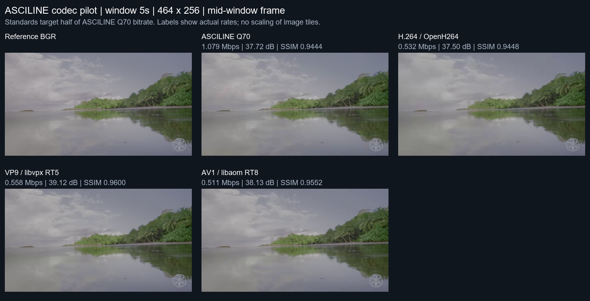
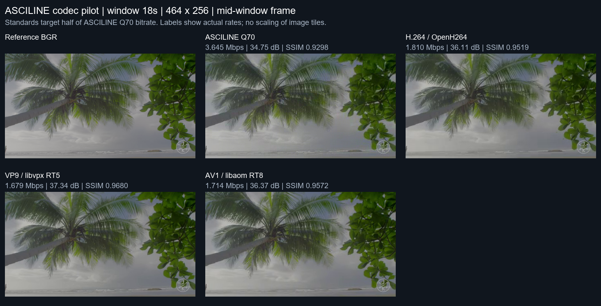
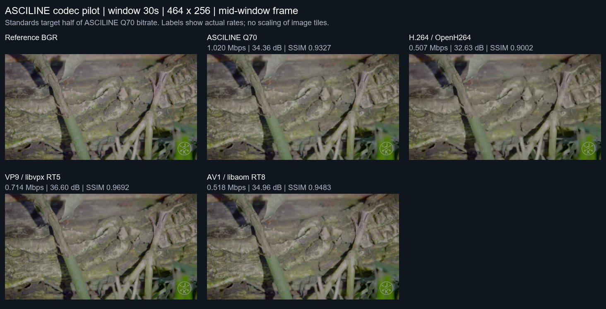
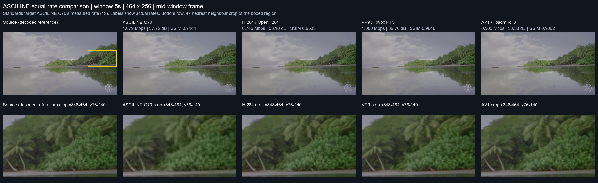
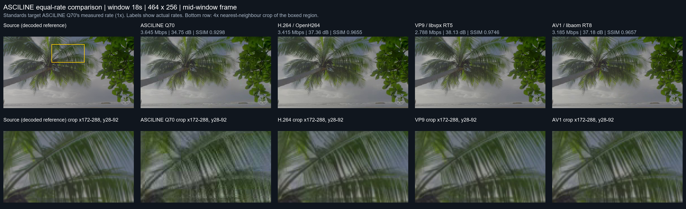
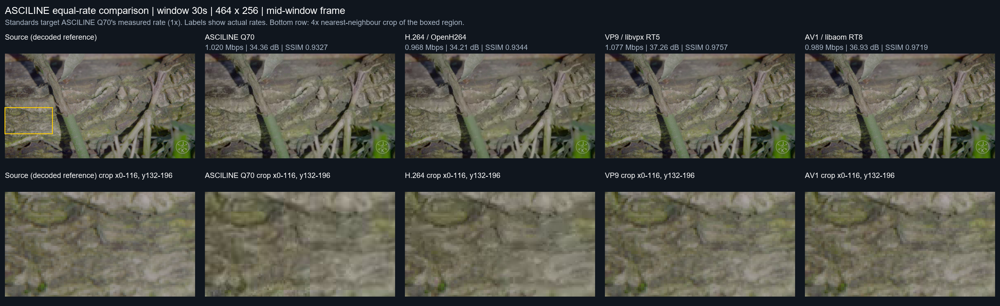

# ASCILINE vs software video encoders: first pilot

Date: 2026-10-01, re-run 2026-10-15 with identical measurements. Source checkout: `8bb7d31593d1e3cde984efa47861fd1c6e4be607`.
Native DLL SHA256: `120066ba8fdddaa1966202b5265a49e419e911bcb416080c573b3b8c2ada73e9`.
FFmpeg: `ffmpeg version n8.1.3-14-g330caae0c1-20261003 Copyright (c) 2000-2026 the FFmpeg developers`.

## Finding

In these three short natural-video windows, the selected VP9 and AV1 real-time
settings give higher RGB PSNR and RGB SSIM than ASCILINE Q70 at roughly half the
aggregate video payload rate. H.264/OpenH264 at that target is mixed by scene;
it is not x264 and must not be presented as a best-H.264 result. This pilot does
not establish a compression-efficiency advantage for ASCILINE over standard
codecs. The independently demonstrated achievement remains its custom
Rust/WebSocket/JavaScript/Canvas pipeline operating near 60 FPS at this grid.

## Aggregate: ASCILINE Q70 vs half-rate targets

Actual measured payload rates, **not requested encoder bitrates**:

| Encoder | Actual Mbit/s | RGB PSNR dB (higher better) | RGB SSIM (higher better) |
| --- | ---: | ---: | ---: |
| ASCILINE Q70 | 1.915 | 35.37 | 0.9356 |
| H.264 / OpenH264 | 0.950 | 34.91 | 0.9323 |
| VP9 / libvpx RT5 | 0.984 | 37.56 | 0.9657 |
| AV1 / libaom RT8 | 0.914 | 36.30 | 0.9536 |

Standard-codec targets were half the ASCILINE Q70 rate **for each scene**.
Actual output can undershoot or overshoot; see the full sweep below. Rates
aggregate equal-duration windows. Aggregate PSNR is computed from pooled pixel
MSE, not the arithmetic average of dB scores. SSIM averages equal frame counts.
No interpolation or equal-quality bitrate claim is made from these few points.

## Method

- One local AV1 source video, Costa Rica (footage by Jacob + Katie Schwarz), three 180-frame windows starting at
  5s, 18s and 30s (540 unique input frames; about nine seconds total).
- Every encoder receives the **same predecoded BGR frames**, 464x256 at
  60000/1001 FPS. No source decoding or live frame dropping in encoding tests.
- ASCILINE Q50/Q70/Q90, dead-zone .75, skip threshold 256, zlib level 3;
  every 48th encoded frame is a keyframe. Fresh encoder for each window.
- Standards: OpenH264 bitrate mode without frame skipping; libvpx-vp9 realtime
  cpu-used 5; libaom-av1 realtime cpu-used 8. Software, one encoder thread,
  maximum GOP 48; VP9/AV1 lag-in-frames 0 and auto-alt-ref 0. YUV420P output.
  No GPU encoding, offline slow preset or multi-pass rate control.
- Standard-codec target rates: .5x, 1x and 2x that scene's measured ASCILINE Q70
  payload rate. Codec configuration and complete commands are saved in JSON/logs.
- Native ASCILINE reconstructed BGR is verified frame-for-frame by the shipped
  root `codec.js` running in Node (all 1,620 encoded frames across three qualities).
  Standard bitstreams are decoded by FFmpeg back to BGR. Decoded byte counts must
  match the reference exactly. RGB PSNR includes all channels and color-conversion
  error. FFmpeg SSIM uses planar RGB (`gbrp`) at the same native resolution.
- Payload size: ASCILINE wire packets including their headers (excluding the
  benchmark file's 4-byte length wrappers); standards sum video packet sizes
  plus codec extradata, excluding Matroska muxing overhead. Audio and WebSocket/
  TCP/IP overhead are excluded on both sides.

## Limits and interpretation

This is a reproducible **pilot**, not a broad codec ranking: one already-lossy
source, small resolution, short clips, few operating points and one machine.
The decoded source is a common reference; its earlier AV1 compression cannot
be measured or undone. Each implementation and preset matters. PSNR/SSIM are
objective reconstruction metrics, not a complete perceptual-quality verdict.

VMAF was deliberately not scored on these tiny native frames. Its default
viewing assumptions need appropriate common display scaling; low-resolution
native scores can look misleadingly high. See the
[Netflix VMAF FAQ](https://github.com/Netflix/vmaf/blob/master/resource/doc/faq.md).
Metric filters are documented in the
[FFmpeg filter manual](https://ffmpeg.org/ffmpeg-filters.html#ssim).

Timing fields are diagnostic, not directly equivalent measurements: ASCILINE
records individual native encode calls; FFmpeg `-benchmark` rtime includes its
raw-file input, conversion, encoding and output pipeline. Node JS decode timing
is not browser/Canvas playback and should not replace the user's browser logs.
The sweep does not measure network latency, seek recovery, browser hardware
decoding, energy use or comparable peak memory. Those need a separate playback
benchmark. No source-dependent adaptive bitrate tuning is claimed for ASCILINE.

## Full rate/quality sweep

| Start | Encoder / setting | Actual Mbit/s | RGB PSNR dB | RGB SSIM |
| ---: | --- | ---: | ---: | ---: |
| 5s | asciline-q50 | 0.764 | 36.42 | 0.9348 |
| 5s | asciline-q70 | 1.079 | 37.72 | 0.9444 |
| 5s | asciline-q90 | 2.429 | 39.92 | 0.9563 |
| 5s | h264-openh264-0.5x | 0.532 | 37.50 | 0.9448 |
| 5s | h264-openh264-1x | 0.745 | 38.16 | 0.9505 |
| 5s | h264-openh264-2x | 0.764 | 38.18 | 0.9507 |
| 5s | vp9-vpx-rt5-0.5x | 0.558 | 39.12 | 0.9600 |
| 5s | vp9-vpx-rt5-1x | 1.080 | 39.70 | 0.9646 |
| 5s | vp9-vpx-rt5-2x | 1.891 | 39.95 | 0.9664 |
| 5s | av1-aom-rt8-0.5x | 0.511 | 38.13 | 0.9552 |
| 5s | av1-aom-rt8-1x | 0.963 | 38.58 | 0.9602 |
| 5s | av1-aom-rt8-2x | 1.852 | 38.90 | 0.9624 |
| 18s | asciline-q50 | 2.301 | 33.60 | 0.9124 |
| 18s | asciline-q70 | 3.645 | 34.75 | 0.9298 |
| 18s | asciline-q90 | 8.660 | 37.19 | 0.9567 |
| 18s | h264-openh264-0.5x | 1.810 | 36.11 | 0.9519 |
| 18s | h264-openh264-1x | 3.415 | 37.36 | 0.9655 |
| 18s | h264-openh264-2x | 5.450 | 38.05 | 0.9718 |
| 18s | vp9-vpx-rt5-0.5x | 1.679 | 37.34 | 0.9680 |
| 18s | vp9-vpx-rt5-1x | 2.788 | 38.13 | 0.9746 |
| 18s | vp9-vpx-rt5-2x | 4.635 | 38.76 | 0.9795 |
| 18s | av1-aom-rt8-0.5x | 1.714 | 36.37 | 0.9572 |
| 18s | av1-aom-rt8-1x | 3.185 | 37.18 | 0.9657 |
| 18s | av1-aom-rt8-2x | 5.815 | 37.70 | 0.9710 |
| 30s | asciline-q50 | 0.705 | 32.94 | 0.9094 |
| 30s | asciline-q70 | 1.020 | 34.36 | 0.9327 |
| 30s | asciline-q90 | 2.393 | 36.77 | 0.9614 |
| 30s | h264-openh264-0.5x | 0.507 | 32.63 | 0.9002 |
| 30s | h264-openh264-1x | 0.968 | 34.21 | 0.9344 |
| 30s | h264-openh264-2x | 1.243 | 34.94 | 0.9470 |
| 30s | vp9-vpx-rt5-0.5x | 0.714 | 36.60 | 0.9692 |
| 30s | vp9-vpx-rt5-1x | 1.077 | 37.26 | 0.9757 |
| 30s | vp9-vpx-rt5-2x | 2.022 | 38.18 | 0.9835 |
| 30s | av1-aom-rt8-0.5x | 0.518 | 34.96 | 0.9483 |
| 30s | av1-aom-rt8-1x | 0.989 | 36.93 | 0.9719 |
| 30s | av1-aom-rt8-2x | 1.925 | 38.12 | 0.9824 |

## Visual samples

Native-size mid-window frames; a single still does not show temporal artifacts.
These sheets use the same half-rate comparison as the aggregate table.
They are stored losslessly (WebP, pixel-identical to the generated PNGs) so the
comparison is not altered by image compression; regenerate them with the commands below.





<sub>Source footage: Costa Rica clip by Jacob + Katie Schwarz. Frames are shown only to compare codec output.</sub>

## Equal-rate comparison

What does each encoder's output look like at about the same bandwidth? Standard
encoders were given ASCILINE Q70's measured per-scene rate as their target (the
`1x` points). The table reports **actual** payload rates; "Rate vs Q70" below 1
means the encoder undershot and spent fewer bits than ASCILINE did.

| Start | Encoder | Actual Mbit/s | Rate vs Q70 | RGB PSNR dB | RGB SSIM |
| ---: | --- | ---: | ---: | ---: | ---: |
| 5s | ASCILINE Q70 | 1.079 | 1.00 | 37.72 | 0.9444 |
| 5s | H.264 / OpenH264 | 0.745 | 0.69 | 38.16 | 0.9505 |
| 5s | VP9 / libvpx RT5 | 1.080 | 1.00 | 39.70 | 0.9646 |
| 5s | AV1 / libaom RT8 | 0.963 | 0.89 | 38.58 | 0.9602 |
| 18s | ASCILINE Q70 | 3.645 | 1.00 | 34.75 | 0.9298 |
| 18s | H.264 / OpenH264 | 3.415 | 0.94 | 37.36 | 0.9655 |
| 18s | VP9 / libvpx RT5 | 2.788 | 0.76 | 38.13 | 0.9746 |
| 18s | AV1 / libaom RT8 | 3.185 | 0.87 | 37.18 | 0.9657 |
| 30s | ASCILINE Q70 | 1.020 | 1.00 | 34.36 | 0.9327 |
| 30s | H.264 / OpenH264 | 0.968 | 0.95 | 34.21 | 0.9344 |
| 30s | VP9 / libvpx RT5 | 1.077 | 1.06 | 37.26 | 0.9757 |
| 30s | AV1 / libaom RT8 | 0.989 | 0.97 | 36.93 | 0.9719 |
| **all** | **ASCILINE Q70** | **1.915** | **1.00** | **35.37** | **0.9356** |
| **all** | **H.264 / OpenH264** | **1.709** | **0.89** | **36.22** | **0.9501** |
| **all** | **VP9 / libvpx RT5** | **1.648** | **0.86** | **38.25** | **0.9716** |
| **all** | **AV1 / libaom RT8** | **1.712** | **0.89** | **37.51** | **0.9659** |

At native 464x256 the five frames are hard to tell apart; the differences show
in the zoomed crops. Even though the standard encoders spent slightly *fewer*
bits overall (0.86-0.89x of ASCILINE Q70; OpenH264 undershot to 0.69x at 5s and
VP9 to 0.76x at 18s), pooled RGB PSNR is about 2.9 dB higher for VP9, 2.1 dB for
AV1 and 0.9 dB for OpenH264. In the crops ASCILINE shows visible 8x8 block
structure and loses fine texture (palm fronds at 18s, foliage at 5s), while VP9
and AV1 keep more texture with smoother edges. OpenH264 is roughly on par with
ASCILINE only in the 30s window. Because the standards undershot, these points
slightly understate their advantage. ASCILINE is not a more bit-efficient codec;
its value is the programmable per-cell representation shared by the ASCII and
pixel modes, decoded by plain JavaScript into Canvas at about 60 FPS.

Sheets show the source and each encoder's mid-window frame at native size, plus a
4x nearest-neighbour crop of the 116x64 region with the most source detail
(boxed in yellow). A single still does not show temporal artifacts.





<sub>Source footage: Costa Rica clip by Jacob + Katie Schwarz. Frames are shown only to compare codec output.</sub>

## Reproduce

```powershell
python experiments/rust_audit/codec_benchmark.py
python experiments/rust_audit/summarize_codec_benchmark.py
```

`output/codec-benchmark/results.json` contains all measurements and software
identifiers. Per-run logs preserve commands and FFmpeg diagnostics, standard
bitstreams remain available, and ASCILINE packets retain reconstruction hashes
and Node verification results. Large temporary BGR files are removed after each
scene. Benchmark scripts/report are separate from the safety checkpoint; the
player, native codec and server implementation were not changed for this pilot.
